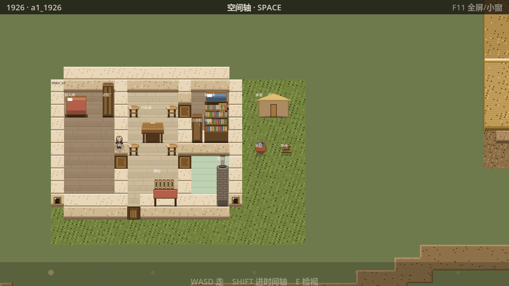
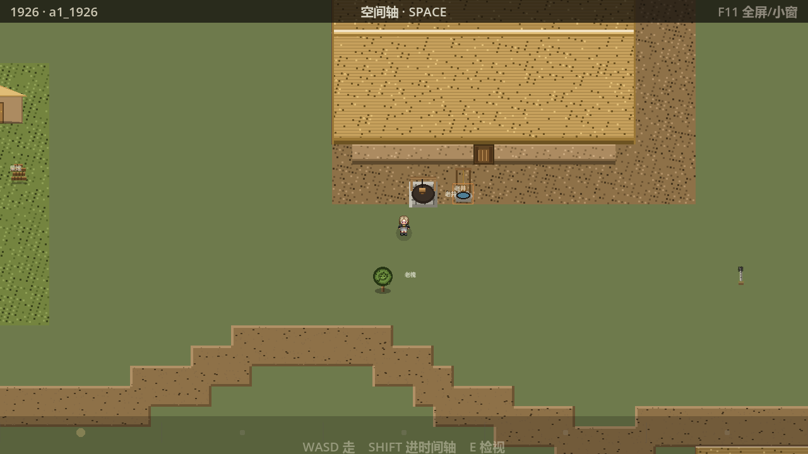
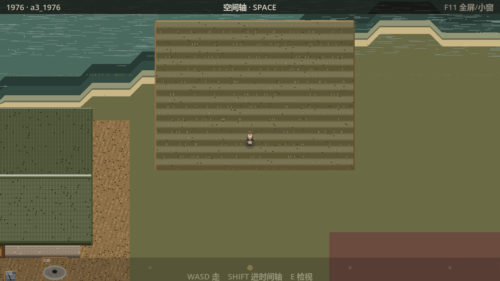

# 阈限迁移 SHIFT

> 一个看不见的归档员，在同一座村庄的五个时代里，归档一桩跨越四代人的旧案。

**SHIFT** is a pixel narrative game about an archivist nobody can see. Space stays frozen; time moves. Walk the same village across five eras, press **Shift** to travel through time, and piece together a family's unfinished story from what people left behind.

Made with [Godot 4](https://godotengine.org/) for [GitHub Game Off](https://gameoff.dev/).



## 玩法

你是一名世界刑侦陈列馆的归档员——没有人能看见你，你也无法改变已经发生的事。你唯一能做的，是在同一片空间里切换时间点，观察同一个地方在不同年代留下的痕迹：一次改过的地质报告、一口被填平的老井、一间换了招牌的铺子。

**空间冻结、时间可动、位置不变**——这既是玩法，也是故事本身。散落在场景里的线索都以「未确认」标注：它为你指方向，却不给你答案。「未确认」这三个字，就是玩法的一部分。

- 在五个时代之间切换，对比同一地点的变迁。
- 靠近物件按检视键，收集证物与线索。
- 把四代人的碎片拼起来，还原一桩旧案的全貌。

### 操作

| 按键 | 作用 |
|---|---|
| `W` `A` `S` `D` | 移动 |
| `Shift` | 切换时代（1926 → 1951 → 1976 → 2001 → 2026） |
| `E` | 检视物件 / 查看线索 |

## 五个时代

| 年份 | 关键词 |
|---|---|
| 1926 | 老井、老槐、最初的村庄 |
| 1951 | 水坝、田地、水泥井 |
| 1976 | 磨坊、旧屋、时代转折 |
| 2001 | 新居、证物、四代人的交汇 |
| 2026 | 笔直的十字路口、超市、玩具店、小学 |




## 运行

需要 **Godot 4.x**（项目 `config_version=5`，视口 1280×720）。

1. 克隆仓库：`git clone https://github.com/lyhtakeashot/liminal-shift.git`
2. 用 Godot 4 打开项目根目录的 `project.godot`。
3. 按 F5 运行（主场景 `res://scenes/main.tscn`）。

> 当前进度：1926 / 1951 / 1976 三个时代可完整体验；2001 / 2026 的地图帧仍在制作中。游戏在缺少美术素材时会自动回退为色块绘制，因此任何时候都能运行。

## 项目结构

```
.
├── project.godot          # Godot 4 项目配置
├── scenes/                # 主场景
├── scripts/               # 引擎逻辑（时间轴、相机、世界渲染、HUD、玩家）
├── data/frames.json       # 五个时代的地图帧（地标、房屋、热点）
├── assets/village/        # 美术素材
│   ├── houses/            # 房屋贴图（base / roof 两层）
│   ├── props/             # 家具、道具
│   ├── scene/             # 河、路、田、井、树、地面
│   └── _classmate/        # 共创者提供的素材暂存区
├── _ref/                  # 房屋设计数据与素材生成脚本
├── docs/                  # 设定、玩法、交接文档
└── _mdtest/               # 回归测试与验收截图
```

## 参与美术共创

欢迎为游戏补充像素素材。规则很简单：

1. **像素单位**：所有素材以 **32px 为最小量化单位**（尺寸均为 32 的整数倍）。
2. **素材去向**：房屋放 `assets/village/houses/`，家具道具放 `props/`，场景元素放 `scene/`。
3. **参考现有素材**：`assets/village/_classmate/` 里有已导入的样例，可对照尺寸与风格。
4. **提交流程**：不要直接改 `main` 分支——

```bash
git checkout -b art/你的名字
# 放入素材
git add assets/village/
git commit -m "添加 XX 素材"
git push origin art/你的名字
```

然后在网页上开一个 **Pull Request**，审核通过后合并。这样大家的改动互不覆盖。

## 技术说明

- 纯 2D、GDScript、Godot 4，无第三方运行时依赖。
- 格子尺寸 32px；世界随时代帧数据驱动，房屋与热点来自 `houses_data.json`。
- 渲染采用「底边 y 排序 + 半高南/东墙」的伪 3D 遮挡方案，玩家与场景对象按深度统一排序。
- 六个回归套件覆盖世界合法性、相机、显示参数、HUD 布局、资产消费与深度排序。

## 参赛与许可

本项目为 GitHub Game Off 参赛作品。故事设定、文本与代码版权归项目作者所有；共创者保留其提交素材的署名权。如需商用或再分发，请先联系作者。
