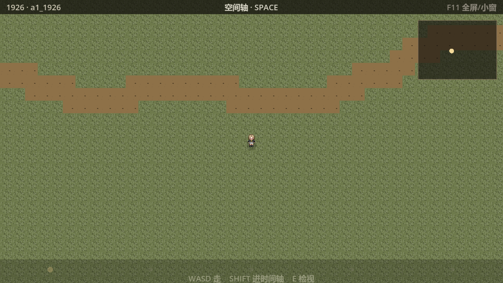
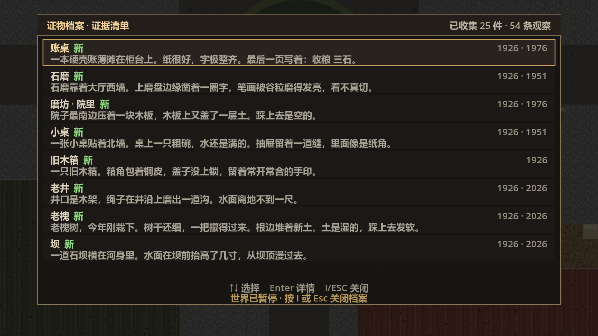
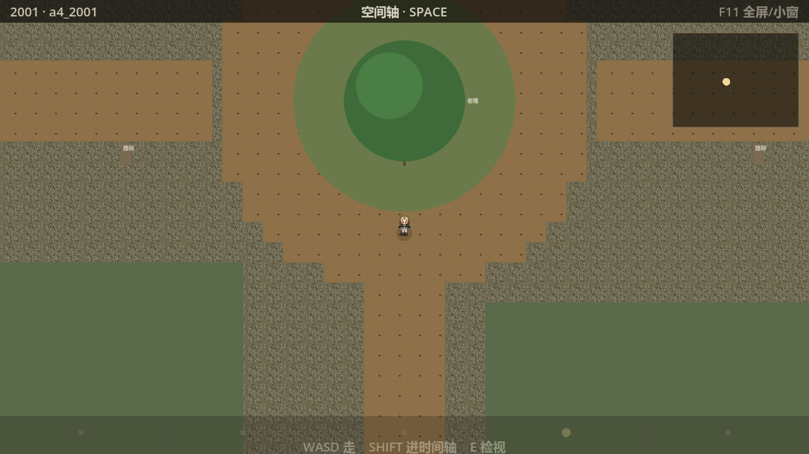
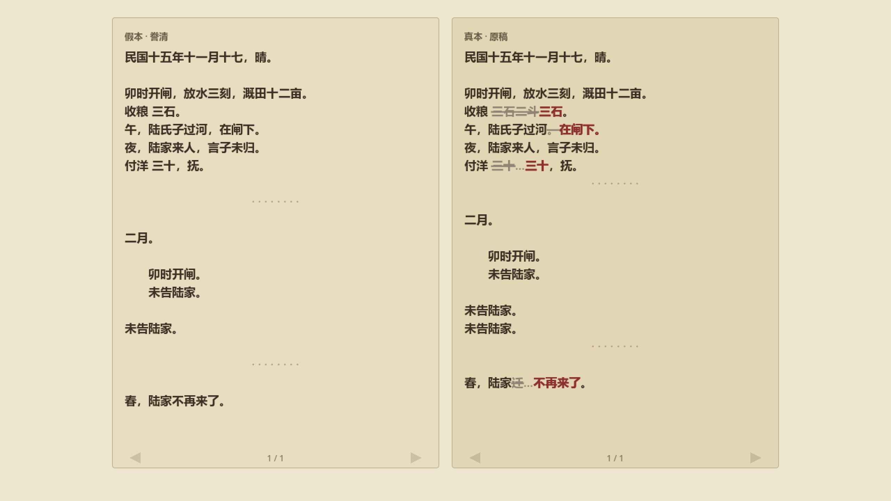
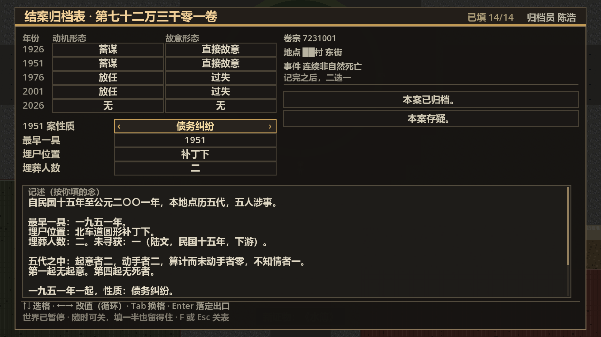
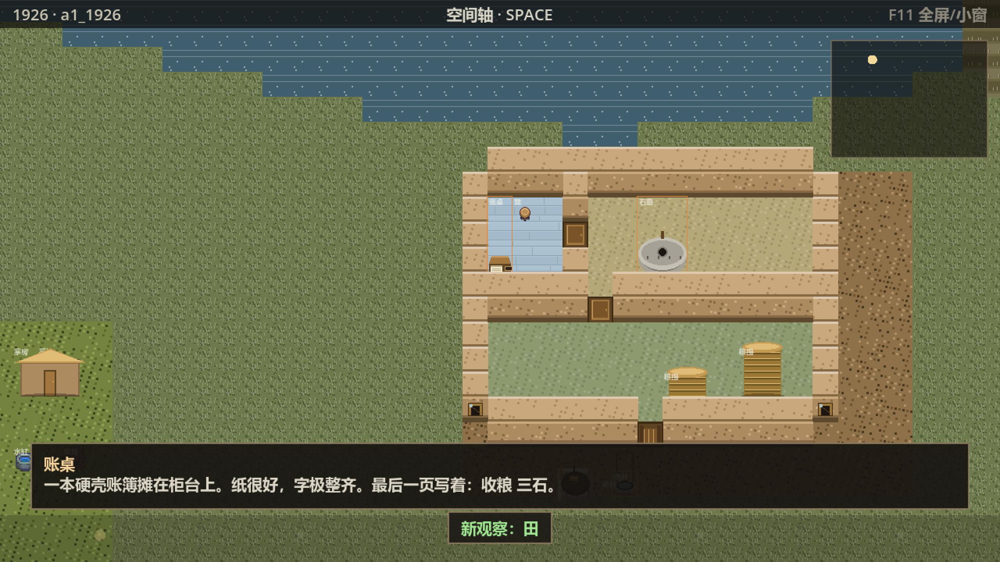
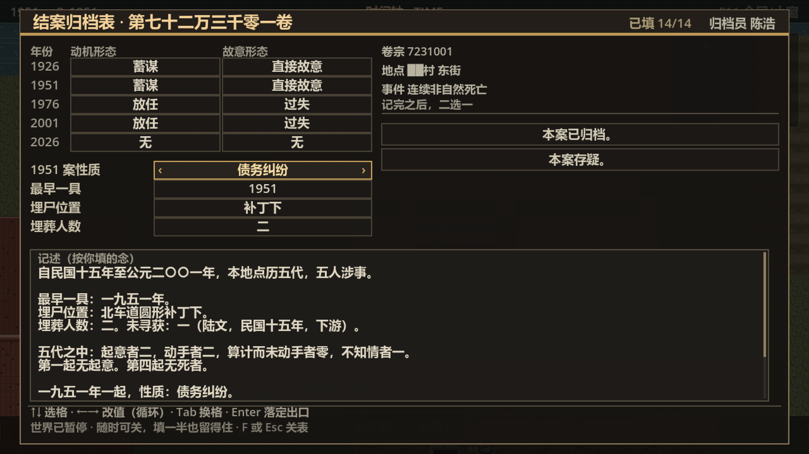

# LIMINAL SHIFT · 阈限迁移

> *The world turns over. He stays where he is, watching the clouds pass.*
> 世界翻覆过去，他站在原地，看云。

A pixel narrative game about an archivist nobody can see, filing a case that has been
open for a hundred years in the same village across five eras.

- **Jam:** [GitHub Game Off](https://gameoff.dev/)
- **Engine:** Godot 4.7 (GDScript, GL Compatibility renderer)
- **Repository:** <https://github.com/lyhtakeashot/liminal-shift>
- **Platform:** desktop (tested on Windows), 1280×720, keyboard-first
- **Screenshots:** [`_mdtest/qa/`](../_mdtest/qa/)

---

## 1. Hook & three sentences

**Hook.** You cannot change a single thing that already happened. You can only stand in
the same spot and watch the century move.

**Three sentences.**

1. You are an archivist from the World Forensic Exhibition Hall; nobody can see you, and
   nothing you do leaves a mark on the village.
2. Space is frozen and only time moves: press **Shift** and the whole map re-renders in
   place — 1926, 1951, 1976, 2001, 2026 — while you keep standing exactly where you stood.
3. Walk a street in five eras, inspect what four generations left behind, read the mill's
   water ledger against the year it was written, and file the case: when did the first
   body go in, where was it buried, how many were there.

**中文 · 一句话钩子。** 你改变不了任何已经发生的事，只能在同一个位置看着一百年从眼前走过去。

**中文 · 三句玩法。**

1. 你是世界刑侦陈列馆的归档员——没人看得见你，你做的任何事都不会在村子里留下痕迹。
2. 空间冻结、时间可动：按 **Shift** 切到时间轴，整张地图在你脚下原地换年头（一九二六 / 一九五一 / 一九七六 / 二〇〇一 / 二〇二六），而你一步没挪。
3. 用五个年代走同一条街，检视四代人留下的东西，把磨坊的《水簿》按年份对着读，最后把卷宗交上去：最早那一具是哪年下去的、埋在哪、一共几个人。

---

## 2. Controls

Every row below was read off the shipped input map (`project.godot` `[input]`) and the
input handlers in `scripts/main.gd`, `scripts/evidence_archive.gd`,
`scripts/ending_form.gd`, `scripts/diary_view.gd`. There are no unreachable or
undocumented bindings.

| Key | Action |
|---|---|
| `W` `A` `S` `D` / arrow keys | Walk (space axis) |
| `Shift` | Toggle between the space axis and the time axis |
| `W` `S` (on the time axis) | Push time: `W` = later year (toward 2026), `S` = earlier year (toward 1926) |
| `A` `D` (while phasing) | `A` = push deeper into the solid, `D` = back out toward open ground |
| `E` | Inspect whatever is next to you; on the mill's **水簿** spot, open / close the ledger |
| `I` | Open / close the evidence archive |
| `G` | Open / close the case filing form (归档表) |
| `F11` or `Alt`+`Enter` | Toggle fullscreen / windowed |

Panels:

| Where | Keys |
|---|---|
| Evidence archive — list | `↑` `↓` pick a card, `Enter` open its observations, `Esc` (or `I`) close |
| Evidence archive — detail | `↑` `↓` scroll the observations, `Esc` / `Enter` back to the list |
| Case form | `Tab` / `Shift`+`Tab` jump between fields, `↑` `↓` change field, `←` `→` change the selected option, `Enter` next field, `Esc` (or `F`) close |
| Case form — exits | With the focus on **已归档** or **存疑**, `Enter` settles the case and closes the form |
| The water ledger | `←` `→` (or `↑` `↓`) turn pages, `E` / `Esc` close |

Mouse is optional: the ledger turns pages when you click its page arrows or scroll the
wheel, and the case form accepts a click on any field. Walking and the archive are
keyboard-only.

Axis behaviour worth knowing:

- On the time axis you keep your **position**; only the year under your feet changes.
- `0.30 s` after the first step time starts repeating every `0.13 s`, so holding `W` or `S`
  scrubs the century quickly.
- If the spot you are standing on is occupied in the era you step into, you enter
  **phasing** (虚化): you can still step time (`W`/`S`) and nudge in or out with `A`/`D`
  — up to 48 px deeper along your facing, or up to 256 px back out, after which the game
  searches a 96 px radius for the nearest free spot. You are never dropped into the void.
- While any panel is open the world stops completely and the HUD hides.

---

## 3. Five steps to the ending

1. **Learn the village (space axis).** Walk with `WASD`. Stand next to anything and press
   `E`; a card opens at the bottom of the screen with the title of the thing and what the
   archivist can observe about it. Press `I` any time to see how much you have filed.
2. **Switch to the time axis.** Press `Shift`. The top-left label changes from
   `空间轴 · SPACE` to `时间轴 · TIME`. Now `W`/`S` push time while your position stays
   fixed. Walk the same street in five eras and watch what changes and what stubbornly
   does not.
3. **Collect what is left behind.** 25 cards / 54 observations across the five frames; the
   same object usually has a *different* observation in each era (the mill's ledger desk
   alone has three, one per year it appears in). Landmarks and house furniture share the
   archive by family, so a bench you found in 1926 keeps its 2001 observation in the same
   card.
4. **Read the water ledger.** In the mill, find the **水簿** spot (present in 1926, 1951 and
   1976) and press `E`. Two eras are laid side by side; `←` `→` turn pages. Opening it also
   files a copy of the ledger into your archive — one card, one observation per era you open
   it in, which is why a full archive reads 26 cards / 57 observations and not 25 / 54.
5. **File the case.** Press `G` to open the filing form. Fill five rows × two columns
   (each era's *motive* and *intent*), then the four case questions, and finally settle it
   on **已归档** (archived) or **存疑** (left open) with `Enter`. The narrative report on the
   right of the form is generated from what you filled — the case file writes itself from
   your answers, and the prose changes shape depending on them.

<strong>Spoilers — the answers the game is looking for</strong>

The four case questions decide the variant of the report:

- **最早一具 / earliest body:** 1951
- **埋尸位置 / burial spot:** 补丁下 (under the patch)
- **埋葬人数 / how many:** 二 (two)
- **1951 案件形态 / the 1951 case:** 债务纠纷 (a debt dispute)

These four produce the report's first variant — the version in which the paragraph about
the thirty-seven payments exists at all. Answering 杀人灭口 for 1951 removes that paragraph;
filling anything as **无法确定** (undetermined) downgrades the report instead of completing
it. Settling the case on either exit changes the report's closing lines and nothing else:
**the village itself looks exactly the same either way.** That is the point — the archivist
files, the world does not move.

---

## 4. Technical notes

- **One scene, one renderer.** `scenes/main.tscn` is a 36-line scene: `Main` (Control) with
  `CameraRig → WorldView + Player`, plus `HUD` and `DisplayManager`. The whole village is
  drawn by a single custom `_draw` in `scripts/world_view.gd` (~700 lines) — no TileMap
  nodes, no shaders, no third-party addons.
- **Space frozen, time swapped.** `scripts/timeline.gd` owns the five frames and a single
  `char_pos`. Switching the time axis never touches `char_pos`; `scripts/world_view.gd`
  simply re-renders against a different `FrameData`, which is why the world changes under a
  player who does not move. A hard 0.30 s / 0.13 s step cadence makes scrubbing feel
  mechanical rather than analogue.
- **Phasing instead of blocking.** Because the player may not move sideways in time, a
  time step that lands inside a solid enters phasing (8 px quantised moves, 48 px in,
  256 px out, 96 px fallback search) rather than cancelling the step.
- **Pseudo-3D occlusion.** Everything is sorted by its bottom edge (`y` of the feet) so the
  player can walk behind a house wall and in front of the next one; south and east house
  walls are drawn at half height so a 32 px grid still reads as a building you can stand
  inside. Roof visibility is recomputed per frame, never cached.
- **Everything is data.** `data/frames.json` (~100 KB) carries five frames: world extent
  4800×3600 px, start frame `a5_2026`, start position `(2048, 1864)`, and 24 hand-written
  hotspots (5/5/5/5/4). `_ref/houses/houses_data.json` carries the houses themselves;
  clue furniture is turned into hotspots at runtime (`scripts/house_shape.gd`). Adding a
  clue is a JSON edit, not a code edit.
- **Save data is a plain JSON file** (`user://evidence_archive.json`, falling back to
  `res://.evidence_archive.json` when the user directory is unwritable — which is exactly
  what happens on a locked-down Windows profile). Collections are keyed by house family, so
  one card accumulates observations from every era.
- **Map baking pipeline (stage 1 of 2).** `tools/bake_world_scene.gd` bakes each frame into
  `scenes/world/world_a*.tscn` (seven layers, 326–660 KB each) with a matching TileSet per
  frame; the runtime still draws from `FrameData` directly, so the baked scenes are
  artefacts and can be compared against the live render
  (`_mdtest/scene_bake_check.gd`, `lab/_scene_diff.gd`).
- **16 headless regression suites** in `_mdtest/*check*.gd` (world legality, camera, display
  parameters, HUD layout, asset consumption and depth sorting, phasing, diary rendering,
  evidence archive, ending form and its wiring, house art, scene baking) plus
  `_mdtest/diary_test.gd`. Each one runs with
  `godot --headless --path . -s res://_mdtest/<name>.gd` and reports its own `fails=N` line.
- **No external runtime dependencies.** GDScript + the engine only; no plugins, no network
  calls, no analytics.

---

## 5. Credits & licensing

- **Design, code, writing, level data:** the project author.
- **Art:** all sprites that the game actually draws are generated procedurally by the Python
  scripts committed in `_ref/art/gen/` (`_gen_props.py`, `_gen_scene.py`, `_gen_shells.py`,
  plus their check/preview helpers), then quantised to a 32 px grid. Re-running those
  scripts reproduces the PNGs in `assets/village/{houses,props,scene}/`.
- **Fonts:** Godot's built-in default font only. No external typeface is bundled.
- **Audio:** none. The game ships with no sound at all.
- **Not part of the build:** `assets/village/_classmate/` (art donated by collaborators
  during development) and `assets/village/props/_legacy_ai/` are kept in the repository for
  reference and future integration, but no runtime code references them, so they do not
  appear in the game.
- **Licence:** story, text and code © the project author. Collaborators keep the attribution
  rights to the assets they contributed. Commercial use or redistribution: contact the
  author first.

中文要点：游戏里真正画出来的贴图全部由仓库内 `_ref/art/gen/` 的 Python 脚本程序化生成
（32px 网格）；字体只用 Godot 内置；没有音频；`_classmate/` 与 `props/_legacy_ai/` 是共创
者留存的参考素材，**没有接入运行时**，不出现在游戏画面里。故事、文本、代码版权归作者，
共创者保留其提交素材的署名权。

---

## 6. Known limitations

We would rather list these than have a judge find them:

- **Seven houses are still flat colour blocks.** The buildings on the 2001 / 2026 frames
  (A4/A5) fall back to solid-colour shells in places where only the A1–A3 art styles are
  finished; the mountains are drawn as flat fills as well. The game is fully playable, the
  art is not finished.
- **No audio whatsoever** — no music, no ambience, no footsteps. Silent by omission, not by
  design.
- **Keyboard first.** Walking, time travel, inspecting and the evidence archive are
  keyboard-only; only the ledger (click its page arrows, or scroll the wheel) and the case
  form (click a field) accept the mouse. No controller support, no remapping UI and no
  settings screen — the display is fixed at 1280×720 with `canvas_items` stretch, so the
  window scales but the pixel grid does not.
- **Narrative is delivered by text alone.** There is no voice, no cutscene, no camera move
  on the ending — settling the case closes the form and says nothing more.
- **The village looks identical between adjacent eras at some spots.** The era difference is
  carried by a per-year colour grade and by which props exist, so 1926 and 1951 can read as
  the same street under slightly warmer light. This is intentional at the story level and
  slightly anticlimactic at the interface level.
- **Map baking is only half wired:** the baked `scenes/world/*.tscn` frames exist and are
  diffed by tests, but the runtime still renders from `FrameData`. Both paths agree today,
  but the switch-over is not done.
- **The in-game README is older than the game** — the GitHub front page still shows the
  three-key control table and a "2001/2026 still in progress" note. This document is the
  accurate one.

---

## 7. Run it

1. Install **Godot 4.7** (developed and tested on `4.7.2.stable`).
2. `git clone https://github.com/lyhtakeashot/liminal-shift.git`
3. Open `project.godot`, press **F5**. Main scene is `res://scenes/main.tscn`.
4. There is nothing to install, nothing to configure, and no account to create. It runs
   from a fresh clone.

---

## Appendix · screenshots

All 12 shots were captured from a real game window at 1280×720 and upscaled 2× with
nearest-neighbour to 2560×1440, so the pixel grid stays crisp. They are committed under
[`_mdtest/qa/`](../_mdtest/qa/).

| # | File | What it shows |
|---|---|---|
| 01 | `01_1926_space.png` | 1926, the start position, space axis |
| 02 | `02_1951_space.png` | 1951, same position — the era changes, the streets do not |
| 03 | `03_1976_space.png` | 1976, same position |
| 04 | `04_2001_space.png` | 2001, same position |
| 05 | `05_2026_space.png` | 2026, same position (the frame the game starts on) |
| 06 | `06_evidence_archive.png` | The evidence archive after a full sweep: `已收集 25 件 · 54 条观察` |
| 07 | `07_diary_shuibu.png` | The mill's water ledger, two eras side by side |
| 08 | `08_ending_form.png` | The case filing form filled in (14/14 fields): five rows × two columns, the four case questions, and the report the table generates on the right — variant 甲, case no. 7231001 |
| 09 | `09_evidence_detail.png` | One card's observations — the mill's ledger desk, three eras |
| 10 | `10_inspect_ledger.png` | Inspecting in the world: the card at the bottom-left with the title and what the archivist can see |
| 11 | `11_time_axis_2026.png` | The time axis: `时间轴 · TIME`, position unchanged |
| 12 | `12_phasing.png` | Phasing (虚化): a time step that landed inside a wall, `A` in / `D` out |

