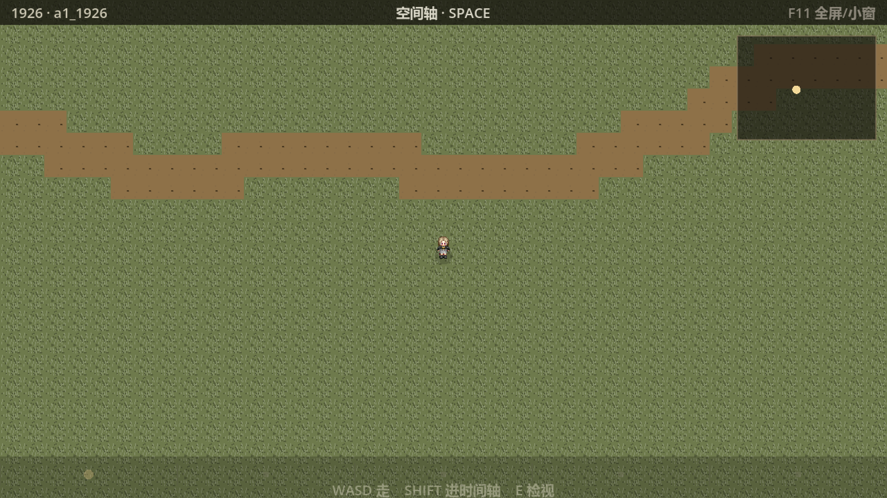
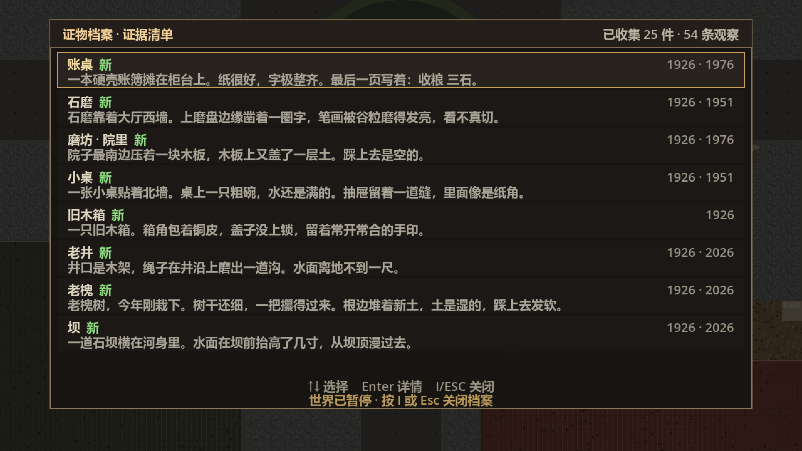
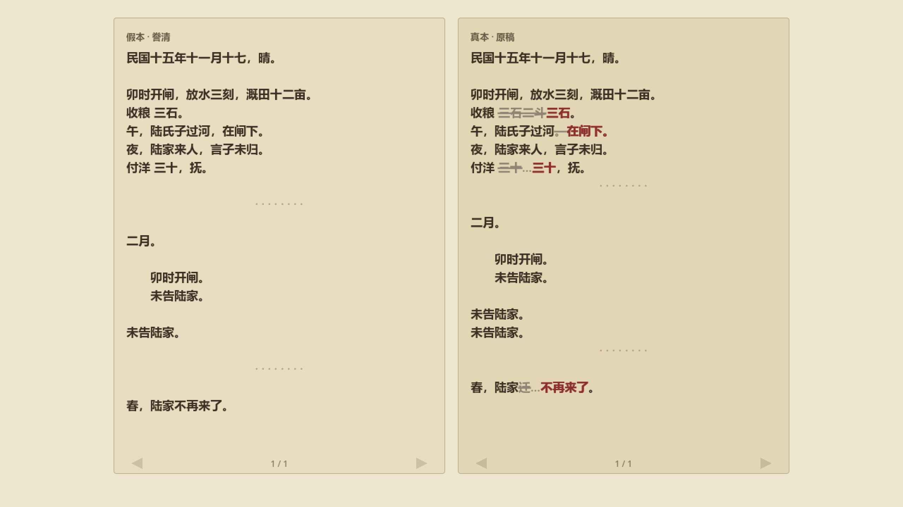
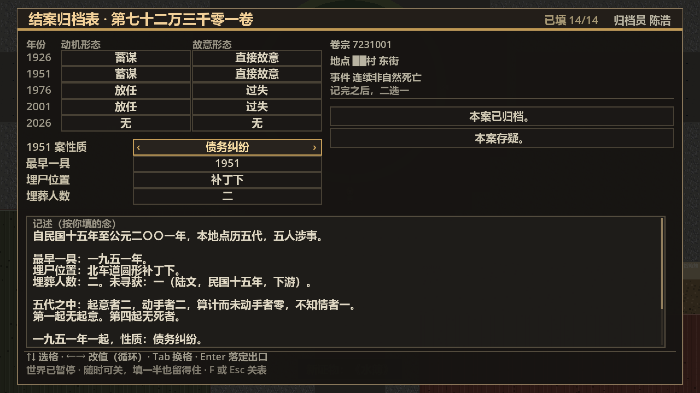

# 《阈限迁移 SHIFT》操作手册

> 你是一个没人看得见的归档员。空间冻结，时间可动，位置不变。
> 在同一座村庄的五个年代里，把一桩悬了一百年的旧案交上去。

---

## 0. 三十秒上手

| 你想干的事 | 按键 |
|---|---|
| 走 | `W` `A` `S` `D`（方向键同效） |
| 看眼前的东西 | `E` |
| 换年代 | 先按 `Shift` 切到时间轴，再按 `W`（往后）/ `S`（往前） |
| 翻已收集的证物 | `I` |
| 交卷（结案归档表） | `G` |

只要记住这五个键，这个游戏就能从头玩到尾。

---

## 1. 你在玩什么

你是世界刑侦陈列馆派来的归档员。村民看不见你，你也**改变不了任何已经发生的事**。

- **空间冻结**：村庄的地形、房子、路，在一百年里该是什么样就是什么样，你一步也挪不动它们。
- **时间可动**：你可以让脚下这片地「原地换年头」——一九二六、一九五一、一九七六、二〇〇一、二〇二六。
- **位置不变**：换年代时你**站在原地**。刚才挡住你的墙，五十年前可能是一道篱笆；刚才的空地，五十年前可能是一间屋子。

目标只有一个：**把卷宗交上去**。要交得出来，你得先把四代人留下的东西看一遍。

---

## 2. 键位总表

### 2.1 走动与时间

| 按键 | 作用 |
|---|---|
| `W` `A` `S` `D` / `↑` `←` `↓` `→` | 空间轴上：走 |
| `Shift` | 切换**空间轴 / 时间轴**（屏幕上方中间的文字会跟着变） |
| `W` | 时间轴上：往**后**推时间（→ 1951 → 1976 → 2001 → 2026） |
| `S` | 时间轴上：往**前**推时间（→ 2001 → 1976 → 1951 → 1926） |
| `A` | 虚化时：往实体**里**走（沿当前朝向，最多 48px） |
| `D` | 虚化时：往**外**退（最多 256px，退不出去会自动在附近找最近的空地） |
| `E` | 检视身边的东西；站在磨坊的**水簿**旁时，翻开 / 合上《水簿》 |
| `I` | 打开 / 关闭**证物档案** |
| `G` | 打开 / 关闭**结案归档表** |
| `F11` 或 `Alt`+`Enter` | 全屏 / 小窗 |

按住 `W` 或 `S` 不放，时间是连着推的：按下先走一步，停 0.30 秒后每 0.13 秒走一步。推到头（1926 或 2026）时，屏幕底条最下沿会闪一条暖色细线。

### 2.2 面板里

| 面板 | 按键 |
|---|---|
| 证物档案 · 列表 | `↑` `↓` 选卡 · `Enter` 展开观察 · `Esc`（或 `I`）关闭 |
| 证物档案 · 详情 | `↑` `↓` 滚动观察 · `Esc` / `Enter` 退回列表 |
| 双日记《水簿》 | `←` `→`（或 `↑` `↓`）翻页 · `E` / `Esc` 合上 |
| 结案归档表 | `Tab` / `Shift`+`Tab` 换栏 · `↑` `↓` 换格（格子里是换年代）· `←` `→` 改选项 · `Enter` 下一格 · `Esc`（或 `F`）关表 |
| 归档表 · 出口 | 焦点停在**已归档**或**存疑**上，按 `Enter` 落定并关表 |

**面板一打开，世界就完全停住，HUD 也会藏起来。** 关掉面板世界才继续——这一条对档案、水簿、归档表都成立。

**鼠标是可选的**：水簿可以点页脚的箭头、或用滚轮翻页；归档表可以点任意一格。走路和档案只认键盘。

---

## 3. 屏幕读法

| 位置 | 内容 | 说明 |
|---|---|---|
| 顶部左侧 | `1976 · a3_1976` | 当前年份 · 帧代号 |
| 顶部中间 | `空间轴 · SPACE` / `时间轴 · TIME` | 现在是哪根轴；时间轴模式下这行会变成暖橙色 |
| 顶部右侧 | `F11 全屏/小窗` | 提示，不用记 |
| 屏幕底条 | 五个刻度点 | 时间轴：当前年代的点更大更亮；**虚化时变成冷蓝色并带一圈虚线光环**；空间轴模式下这条底条会变暗（但不会消失） |
| 底条下方 | 一行操作提示 | 会跟着轴切换：空间轴是 `WASD 走    SHIFT 进时间轴    E 检视`，时间轴是 `W/S 推时间    SHIFT 回空间轴    E 检视` |
| 检视卡（屏幕左下） | 标题 + 一段观察文字 | 站到物件旁按 `E` 才出现；卡片在的时候，底部那行操作提示会让位给它 |

右上角还有一个**小地图**，上面的亮点是你自己。

---

## 4. 时间轴与「虚化」

### 4.1 换年代时会发生什么

按 `Shift`，屏幕中间的字从 `空间轴 · SPACE` 变成 `时间轴 · TIME`。这时候 `WASD` 的四个方向重新解释：

- `W` / `S`：推时间。
- `A` / `D`：只在「虚化」时有用（见下）。

**你的人在换年代时不移动一格。** 整张地图在你脚下原地重画：同一扇门、同一条路，变成另一个年代的样子。

### 4.2 落点被挡住 = 虚化（不是撞墙）

如果目标年代里、你站的这一格是实心的（比如你正站在 2026 年的路面上，而那地方在 1926 年是一间屋子），游戏不会把你弹回去，而是让你**留在原地并进入虚化**：

- 你变成半透明的冷色，屏幕底条上当前年代的点变蓝、带虚线光环。
- 这时候还能继续推时间（`W` / `S`），也可以：
  - 按 `A`：沿你面朝的方向**往里**走，一次 8px，最多 48px；走进去如果是空的，虚化立刻解除。
  - 按 `D`：沿反方向**往外**退，一次 8px，最多 256px；退不出去时，游戏会在 96px 半径内找最近的一格空地把你放过去。
- 实在无路可走时，你**原地不动、保持虚化**——游戏绝不会把你丢进虚空。再按一次会重新找。

### 4.3 常见误会

| 现象 | 原因 |
|---|---|
| 按 `W` 人在走，年代没变 | 你还在空间轴。按 `Shift`，看屏幕中间是否变成 `时间轴 · TIME` |
| 按 `W` 年代变了但画面没怎么变 | 这一带在两三个相邻年代长得确实一样（年代差别靠整体色调和少量物件体现） |
| 按 `W` 人不动了、颜色变冷 | 你虚化了。按 `D` 退出来，或再推一年试试 |

---

## 5. 证物档案（`I`）

按 `E` 检视过的东西都会进档案。按 `I` 打开，顶部右侧写着 **`已收集 N 件 · M 条观察`**。

- 一张「卡」是一个**地方或一件东西**，一张卡里可以有多条**观察**——同一样家具在不同年代被看到，会累进同一张卡里（例：磨坊的账桌在 1926 / 1951 / 1976 三个年代各留下一条观察）。
- 房屋里的家具按「房族」归并，所以你在 1926 年摸过的沈家椅子，到了 2001 年再看，还是同一张卡。
- 列表里 `↑` `↓` 选卡，`Enter` 进详情；详情里 `↑` `↓` 滚动，`Esc` 或 `Enter` 回列表，`I` 或 `Esc` 关掉整个档案。
- **能收多少**：场景里能检视出来的是 **25 张卡 / 54 条观察**（五帧合计）；再算上《水簿》复刻进来的那张卡，档案最多到 **26 件 / 57 条**。

---

## 6. 《水簿》（磨坊的那本册子）

在 1926 / 1951 / 1976 三个年代的**磨坊**里，都有一处标着「水簿」的热点。站过去按 `E`：

- 书会铺开左右两页，**两个年代并排**给你对着读。
- `←` `→` 翻页（`↑` `↓` 同效）；鼠标点页脚箭头或滚滚轮也行。
- 再按 `E`（或 `Esc`）合上。

翻开时它还会把《水簿》**复刻一份进你的档案**：档案里多出一张《水簿》卡（同一年代只记一次），所以场景收满时是 25 件，翻开之后变 26 件。这是正常的，不是 bug。

（注意：场景里那处热点叫「水簿」，复刻进档案的卡叫「《水簿》」——带书名号的才是你手里这本。）

---

## 7. 结案归档表（`G`）

按 `G` 打开。整张表长这样：

- **左边**：五行 × 两列的表格。每行是一个年代，两列分别填那年的**动机**和**故意**形态。
- **中间**：四个单选题——1951 年的案件形态、最早那一具是哪年下去的、埋在哪、一共几个人。
- **左下**：两个出口——**已归档** / **存疑**。
- **右边**：一份**自动生成**的记述。你填一格，右边的文字就跟着变；它不是你写的，是表算出来的。

### 7.1 怎么填

1. `Tab` / `Shift`+`Tab`：按顺序换栏（格子 → 单选 → 出口 → 记述区）。
2. 在格子上：`↑` `↓` 换**年代行**（同列不动），`←` `→` 改这一格的值。
3. 在单选项上：`↑` `↓` 换下一题，`←` `→` 改选项。**所有选项一开始都是空的**——不按 `←` / `→` 就一直是「未填」，按一下才填上第一个选项，再按着往下轮。
4. `Enter`：在格子上 = 跳到下一格；在出口上 = **落定并关表**。
5. `Esc` 或 `F`：直接关表。

**关掉表不会丢东西**——填一半关掉也会自动存盘，下次按 `G` 打开还是你填的样子。

### 7.2 三种记述

| 变体 | 触发条件 | 结果 |
|---|---|---|
| 甲 | 四个单选都填了、且 1951 案件形态不是「杀人灭口」 | 完整记述，含「三十七笔款」那一段 |
| 乙 | 1951 案件形态填「杀人灭口」 | 三十七笔款那一段整段消失 |
| 丙 | 任何一个单选留空或填「无法确定」 | 记述降级：只报能确定的部分，不构成完整卷宗 |

两个出口（已归档 / 存疑）只改变记述的收尾几句。**村子本身一模一样**——你交与不交、怎么交，世界都不会动一下。这是这个游戏想说的话。

---

## 8. 五步通关

<strong>点开看完整流程（含剧透）</strong>

1. **认路。** `WASD` 走一圈，见到东西就按 `E`。按 `I` 看档案涨了多少。
2. **切时间轴。** `Shift`，然后 `W`/`S` 在五个年代之间来回推。同一个位置在五个年代各看一遍——**大部分线索只有对着几个年代才读得出来**（一口被填平的井、一块新铺的石板、一本没写完的账）。
3. **收齐。** 五帧一共 25 张卡 / 54 条观察。不要求全收齐才能交卷，但填得出来多少，取决于你看了多少。
4. **读《水簿》。** 磨坊里按 `E` 翻开，左右两页对读。它会告诉你「谁、哪一年、怎么记的账」。
5. **交卷。** `G` 打开归档表，把格子填完，四个单选题填成：

   - 1951 案件形态：**债务纠纷**
   - 最早一具：**1951**
   - 埋尸位置：**补丁下**
   - 埋葬人数：**二**

   然后把焦点移到**已归档**，按 `Enter`。

---

## 9. 卡住了怎么办

| 症状 | 处理 |
|---|---|
| 按 `E` 没反应 | 站得更近（约两格以内）；或者这东西不在这个年代——切时间轴换个年代再看 |
| 画面全冷色、人在墙里 | 你虚化了。按 `D` 退出，或按 `W`/`S` 再推一年 |
| 时间轴推不动 | 已经到头了（1926 / 2026）。底条会闪一下暖色线 |
| 档案是空的 | 只有按 `E` 检视过的东西才会进档案 |
| 归档表关了，表格空了 | 不会。关表自动存盘；如果确实空了，说明存档目录写不进去（见下） |
| 想从头再来 | 删掉 `user://evidence_archive.json` 与 `user://ending_form.json`。Windows 上在 `%APPDATA%\Godot\app_userdata\shift\`；如果那个目录不可写，游戏会把存档写回项目根目录的 `.evidence_archive.json` |
| 窗口太小 / 想全屏 | `F11` 或 `Alt`+`Enter`。画面按比例缩放，像素格不会变 |

---

## 10. 已知限制

- 2001 / 2026 两帧的部分房屋（A4 / A5 七栋）还是**纯色块**，山体也是平涂；美术没做完，游戏能玩。
- **完全没有声音**：没有音乐、没有环境音、没有脚步。
- 以键盘为主（水簿与归档表可以点鼠标），没有手柄支持，没有改键界面，没有设置菜单。
- 分辨率固定 1280×720 等比缩放，没有「像素完美」的整数倍缩放开关。
- 交卷之后没有演出：表一关就结束了，村子不会变。

---

## 附：怎么跑起来

1. 装 **Godot 4.7**（`4.7.2.stable` 上实测通过）。
2. 用 Godot 打开项目根目录的 `project.godot`，按 **F5**。
3. 主场景是 `res://scenes/main.tscn`，视口 1280×720。没有安装步骤，也不需要账号。

更多截图见 [`_mdtest/qa/`](../_mdtest/qa/)，赛事材料见 [SUBMISSION.md](./SUBMISSION.md)。